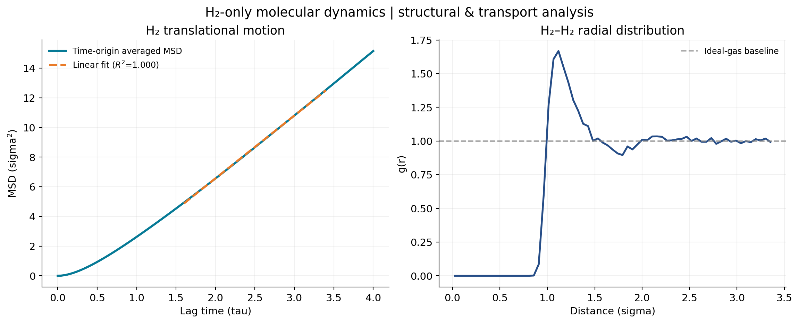
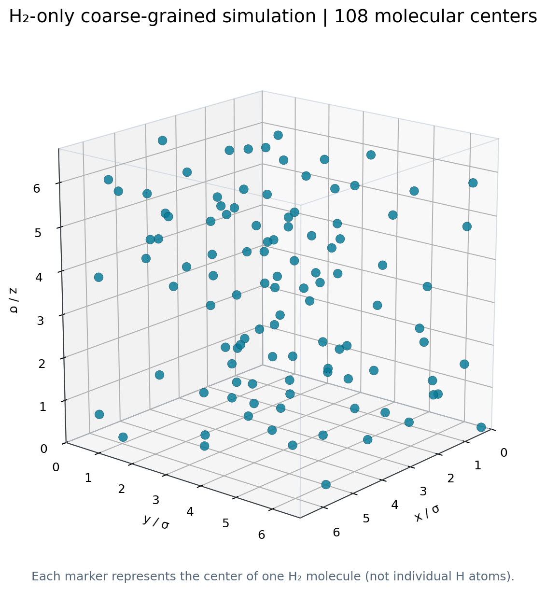
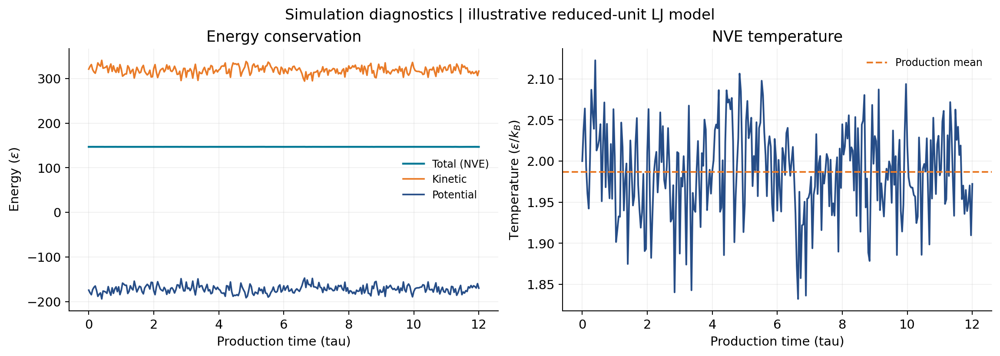

# H₂ Molecular Dynamics Toolkit

**A runnable, Python-first project for simulating and analyzing a simple system containing only H₂ molecular centers.**

This portfolio project demonstrates the complete workflow: **build a periodic simulation → run molecular dynamics → analyze diffusion and structure → produce reproducible figures and CSV results**.





> **Scientific scope:** The built-in MD engine uses a **single Lennard–Jones site per H₂ molecule**, with illustrative *reduced* units. It represents H₂ **centers of mass**, not two bonded H atoms, and uses **no calibrated real-hydrogen force field**. **Do not interpret the demo diffusion values, density, or temperature as quantitatively predictive for hydrogen.** The analysis functions also support actual H₂-center trajectories exported from LAMMPS, with physical units.

## Features

- Self-contained, small **velocity-Verlet** MD with periodic boundaries, minimum-image distances, shifted-force LJ interactions, NVE production, and basic equilibration.
- **Mean-squared displacement (MSD)** with multiple time origins, computed using **unwrapped** molecule-center coordinates.
- **Self-diffusion coefficient** from the long-time Einstein relationship, `D = slope(MSD) / 6` in 3D.
- **H₂–H₂ radial distribution function**, `g(r)`, with correct pair-count and spherical-shell normalization.
- Number density; mass-density conversion for trajectories with Å units.
- Reproducible `.npz` trajectory storage, CSV exports, JSON metrics, and publication-friendly PNG charts.
- Loader for *cubic, constant-volume orthorhombic* LAMMPS `dump custom` with **unwrapped** `xu yu zu`, or `x y z ix iy iz` columns.
- Unit tests, command-line interface, and GitHub Actions continuous integration.

## Installation

Requires **Python 3.10+**. Clone/download this repository, open a terminal in its root, and run:

```bash
python -m venv .venv
# Windows PowerShell:
.venv\Scripts\Activate.ps1
# macOS/Linux: source .venv/bin/activate
python -m pip install -e ".[dev]"
```

## Run your first H₂-only simulation

```bash
h2md demo --output results
```

The demo uses an FCC starting arrangement of **108 H₂ centers**, periodic cubic cell, reduced number density **ρ*=0.35**, reduced target temperature **T*=2.0**, velocity rescaling during **500 equilibration steps**, and **3,000 NVE production steps** (`dt*=0.004`), saving every 10 steps. Random seed: 42.

Files created in `results/`:

| File | Contents |
|---|---|
| `trajectory.npz` | Unwrapped molecular-center coordinates, box and time metadata, thermodynamic traces |
| `h2_analysis.png` | MSD with linear fit and H₂–H₂ RDF |
| `h2_diagnostics.png` | NVE energy components and instantaneous temperature |
| `msd.csv` / `rdf.csv` | Numerical results for reuse |
| `results.json` | Parameters, fitted coefficient, R², density, units and scientific warning |



An example run (including trajectory data, CSVs, and JSON) is committed in [`examples/demo-output/`](examples/demo-output/).

Customize the demo:

```bash
h2md demo --steps 6000 --equil 1000 --seed 7 --output results/run2
```

## Analyze existing LAMMPS trajectories

A real H₂-only LAMMPS simulation needs **one particle per molecular center** to match this version of the analysis. If your original simulation contains **two hydrogen atoms per H₂**, first compute each molecule's **unwrapped center of mass** and export those molecular centers; do not mistakenly interpret H-atom self-diffusion as H₂ molecular self-diffusion.

Use `units real` (coordinates Å and MD timestep fs), a fixed **cubic** cell, and dump columns such as:

```lammps
# From a preconfigured, running LAMMPS H2-center simulation:
dump d1 all custom 100 trajectory.lammpstrj id type xu yu zu
```

Then, for example, if LAMMPS integrates with `timestep 1.0` (fs):

```bash
h2md analyze --input trajectory.lammpstrj --timestep-fs 1.0 --output results/lammps
```

You may also load this tool's saved compressed trajectory:

```bash
h2md analyze --input results/trajectory.npz --output results/reanalysis
```

**Parser limitations:** v0.1 supports constant cubic orthorhombic cells, uniformly spaced frames and consistent particle IDs. It does **not** automatically convert atomic H positions to molecular centers, and does **not** handle triclinic or fluctuating NPT cells. For production research, implement/check robust unwrapping and center-of-mass reconstruction appropriate to the actual topology.

## Scientific methods

**Mean-squared displacement:**

$$\mathrm{MSD}(\tau)=\left\langle \frac{1}{N}\sum_{i=1}^N\left|\mathbf r_i(t_0+\tau)-\mathbf r_i(t_0)\right|^2\right\rangle_{t_0}$$

Positions **must be unwrapped** across periodic boundaries; directly using wrapped coordinates gives false jumps. Default analysis considers lags up to one third of the trajectory, to reduce noisy late-lag estimates.

**Einstein self-diffusion (3D):**

$$D=\frac{1}{6}\frac{d\,\mathrm{MSD}(\tau)}{d\tau}$$

The default fit uses **40–85%** of the analyzed lag interval. This is a configurable *heuristic*, not proof of reaching a diffusive regime. Inspect the MSD, vary the fitting window, extend the simulation, assess convergence with independent runs, and consider uncertainties before making physical claims. To change the fit window:

```bash
h2md analyze --input results/trajectory.npz --fit-start 0.50 --fit-end 0.90
```

**Radial distribution function:** `g(r)` estimates the observed number of *unique* H₂-center pairs per spherical shell, divided by the expected shell count for a uniform fluid at the same number density and box volume. Minimum-image periodic distances are used for radii ≤ L/2.

**Units:** The built-in MD reports `σ²/τ` (diffusion) and molecules per `σ³` (number density). These reduced quantities cannot be converted to SI without separately selecting and validating a physical parameterization. LAMMPS `units real` trajectories report diffusion in `Ų/fs`, also converted to `m²/s` using `1 Ų/fs = 10⁻⁵ m²/s`.

## Use as a Python library

```python
from h2md import simulate_h2_centers, mean_squared_displacement, fit_self_diffusion, radial_distribution

traj = simulate_h2_centers(production_steps=3000)
times, msd = mean_squared_displacement(traj)
fit = fit_self_diffusion(times, msd)
r, g = radial_distribution(traj)
print('Illustrative reduced-unit D:', fit.coefficient)
```

## Project structure

```text
h2-molecular-dynamics-toolkit/
├── src/h2md/             # Simulation, trajectory I/O, analysis, plotting, CLI
├── tests/                # MSD, diffusion, RDF, PBC, energy-conservation tests
├── assets/               # Figures generated from the included demo
├── .github/workflows/    # Automated Python tests
├── pyproject.toml        # Installable package
├── LICENSE
└── README.md
```

## Quality checks

```bash
python -m pytest -q
```

## Next milestones

1. Read fully atomistic, two-H-atom-per-molecule trajectories and compute true unwrapped H₂ center-of-mass positions.
2. Support changing cell dimensions, triclinic PBC, and NPT trajectories.
3. Estimate block-averaged confidence intervals and automate diffusion-regime diagnostics.
4. Compare results with established packages such as MDAnalysis; add MSD FFT acceleration.
5. Introduce validated H₂ force-field parameters and reference conditions (T, P, density), then compare with published data.

## References

- [MDAnalysis: MSD analysis and unwrapped-coordinate requirement](https://docs.mdanalysis.org/stable/documentation_pages/analysis/msd.html)
- [LAMMPS documentation: `dump`](https://docs.lammps.org/dump.html)
- [LAMMPS documentation: `units`](https://docs.lammps.org/units.html)

**Author:** Abdelateef M. Adam | [GitHub profile](https://github.com/Abdelateef13)  
**License:** MIT
