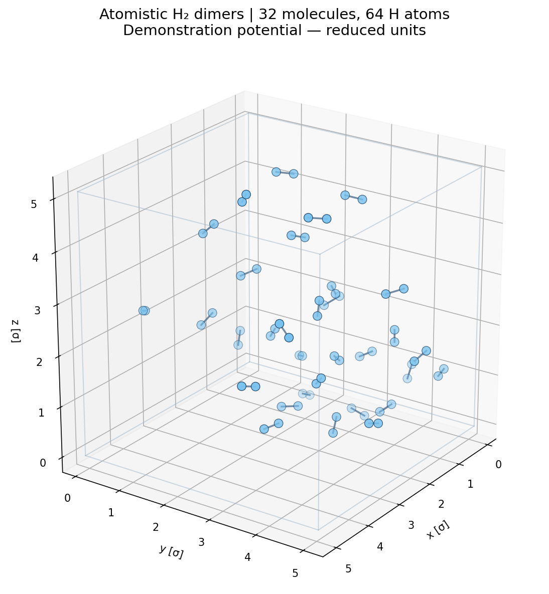
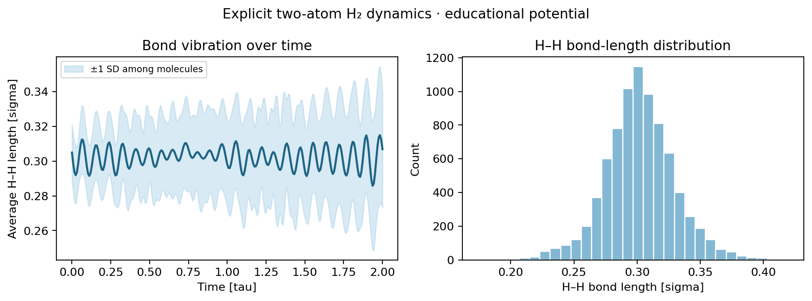
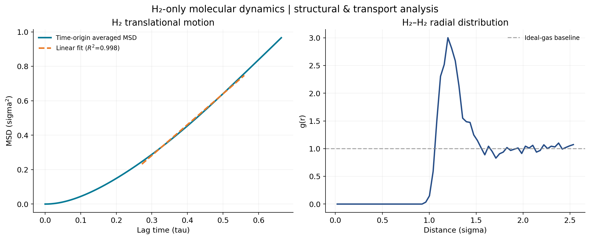
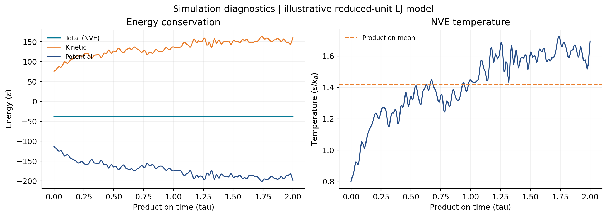

# H₂ Molecular Dynamics Toolkit

[](https://github.com/Abdelateef13/h2-molecular-dynamics-toolkit/actions/workflows/tests.yml)

**Python molecular-dynamics simulation and analysis for hydrogen**, including an explicit **two-hydrogen-atom-per-H₂** simulation, molecular diffusion analysis, H₂–H₂ radial distribution functions, 3D visualization, and import of two-atom H₂ LAMMPS dumps.



### Scientific scope — important

There are two different educational models in this repository:

- **v0.2, `atomistic-demo`:** Two separately integrated H atoms per molecule, flexible **harmonic H–H bond**, **intermolecular** H-site Lennard–Jones interactions, 3D periodic box, velocity-Verlet time integration. Each H has mass `0.5` in reduced units. **This is atom-resolved but not a validated physical H₂ force field.** No H₂ dissociation, quantum nuclear vibrations, or accurate thermodynamic-state predictions are supported.
- **v0.1, `demo`:** The original simplified single-site Lennard–Jones model in which each particle is an entire H₂ center of mass. Retained for comparison and teaching.

**Do not report either demonstration's diffusion coefficients as physical H₂ transport coefficients.** Both built-in models use arbitrary reduced-unit parameters, not calibrated experimental or ab initio potentials. For quantitative results, analyze a validated hydrogen model and documented thermodynamic conditions (temperature, pressure, density) and establish convergence.

## New in v0.2

- Explicit **H₂ = H—H** molecular topology (32 molecules = 64 H atoms by default).
- Harmonic intramolecular H–H bonding; no LJ interaction between the two atoms of the same molecule.
- Periodic-boundary handling that preserves intact bonded molecules for visualization.
- Interactive, **offline Plotly 3D HTML animation** (rotate, zoom, play/pause and scrub frames).
- Static 3D molecular snapshot, H–H bond-length distribution and time series.
- Molecular **COM** trajectory for MSD, self-diffusion, RDF, and density analysis.
- Trajectories saved in atomic `.npz`, molecular-center `.npz`, and OVITO-compatible `.xyz` formats.
- Import of **LAMMPS `dump custom` with `id mol xu yu zu`** for two-atom hydrogen molecules (constant cubic box, `units real`).
- 11 automated Python tests and GitHub Actions CI.

## Example output

| Atomistic 3D H₂ molecules | Bond-length analysis |
|:--:|:--:|
|  |  |

| Molecular MSD & RDF | Energy & temperature diagnostics |
|:--:|:--:|
|  |  |

**[Open/download the interactive H₂ trajectory (HTML)](examples/atomistic-demo/h2_interactive.html)** — Download the file and open it in Chrome/Edge. It includes the visualization engine, so you can run it offline. The browser viewer shows atoms and bonds from the **actual computed trajectory** rather than an artistic illustration.

## Quickstart (Windows)

Requirements: Python 3.10+ and a terminal. In the project folder:

```cmd
py -m venv .venv
.venv\Scripts\activate.bat
python -m pip install -e ".[dev]"
```

Run the new **explicit two-atom H₂ simulation**:

```cmd
h2md atomistic-demo --output results/atomistic
```

Open `results/atomistic/h2_interactive.html` by double-clicking it. Use the **Play** button, drag to rotate the box, scroll to zoom, or click the slider to inspect a frame.

Test the project:

```cmd
python -m pytest -q
```

Expected: **11 passed**. To update an existing v0.1 GitHub repository, follow **[UPGRADE_WINDOWS.md](UPGRADE_WINDOWS.md)** instead of creating a new repository.

### Outputs of `atomistic-demo`

| Output | Meaning |
| --- | --- |
| `h2_interactive.html` | Self-contained interactive 3D atom/bond animation |
| `h2_atomistic_3d.png` | Static 3D snapshot with H–H bonds |
| `h2_bonds.png` | Bond lengths vs time and bond-length histogram |
| `h2_analysis.png` | Molecular-center MSD, diffusion fit, and H₂–H₂ COM RDF |
| `h2_diagnostics.png` | Potential and kinetic energy; temperature vs time |
| `atomic_trajectory.npz` | Unwrapped **atomic** H positions, `(frames, molecules, 2, 3)` |
| `com_trajectory.npz` | Unwrapped **molecular COM** coordinates, `(frames, molecules, 3)` |
| `h2_molecules.xyz` | Animated extended XYZ trajectory, supported by OVITO |
| `msd.csv`, `rdf.csv` | Calculated numerical arrays |
| `results.json` | Parameters, bond statistics, density, fitted diffusion and warnings |

Change number of steps, equilibration, and random seed:

```cmd
h2md atomistic-demo --equil 600 --steps 5000 --seed 7 --output results/longer-run
```

## Analyze actual two-atom H₂ trajectories from LAMMPS

A molecular H₂ system should have **two hydrogen atoms per molecule**, with a stable `mol` ID per bonded pair. Write a *custom* dump in a production LAMMPS run:

```lammps
# Example output directive to add to an otherwise configured H2 LAMMPS input
# units real => coordinates in Å; timestep in fs.
dump d1 all custom 100 h2_atoms.lammpstrj id mol type xu yu zu
dump_modify d1 sort id
```

Analyze if the MD timestep is **0.5 fs** (replace it with your actual value):

```cmd
h2md atomistic-analyze --input h2_atoms.lammpstrj --timestep-fs 0.5 --output results/from-lammps
```

This reconstructs molecular **unwrapped center-of-mass positions** and generates the same diffusion, RDF, and 3D visualization output. The example does **not** supply a validated LAMMPS H₂ force field or claim to generate publishable hydrogen MD simulations. It is an *analysis/import* workflow; use scientifically supported force-field parameters and equilibrated trajectories.

Current importer limitations: **constant cubic orthorhombic box**, consistent atom and molecule IDs, two H atoms per molecule, and uniform frame spacing. **NPT, triclinic boxes, and different atomic species are not yet supported.** Keep atomic unwrapped image flags consistent with the molecular topology.

## Explore XYZ with OVITO

1. Download/install [OVITO Basic](https://www.ovito.org/).
2. Use **File → Load File** to open `results/atomistic/h2_molecules.xyz`.
3. Click Play to animate. The file contains two `H` atoms and a molecule identifier for each H₂.
4. If bonds are not drawn, add the **Create bonds** modifier. For the illustrative demo use a maximum H–H bond distance around `0.5` **reduced σ units** (the average model H–H bond length is `0.3σ`). In a calibrated Å trajectory, select a physically meaningful cutoff instead.
5. Select atoms and bonds, choose colors/radii, and use OVITO's renderer to export pictures or animations.

The built-in HTML viewer draws explicit H–H bonds without needing OVITO or any bond-guessing settings.

## Scientific analysis

The **molecular** center of mass of H₂, not an individual H atom, is analyzed for self-diffusion:

$$\mathbf r_{\mathrm{COM}}(t) = \frac{m_H\mathbf r_{H_1}(t) + m_H\mathbf r_{H_2}(t)}{2m_H}.$$

**Mean-squared displacement** (ensemble and time-origin average):

$$\mathrm{MSD}(\tau) = \langle |\mathbf r_{\mathrm{COM}}(t+\tau)-\mathbf r_{\mathrm{COM}}(t)|^2\rangle.$$

**Einstein self-diffusion coefficient** in three dimensions:

$$D = \frac{1}{6}\,\frac{d\mathrm{MSD}(\tau)}{d\tau}$$

Use **unwrapped** COM trajectories to avoid artificial jumps at periodic boundaries. The default fit window covers **40–85%** of the analyzed lag interval; this is a heuristic only. Check the diffusive regime, fit-window sensitivity, finite-size effects, energy conservation, convergence, and uncertainty from independent simulations.

The RDF, `g(r)`, uses the *molecular COM positions*. The bond-length distribution instead measures explicit atomic distances inside each H₂ molecule. The built-in simulation uses reduced units for length `σ`, time `τ`, energy `ε` and temperature `ε/k_B`. There is **no justified conversion to Å, kelvin, or m²/s** without a validated parameter mapping.

## Repository structure

```text
h2-molecular-dynamics-toolkit/
├── src/h2md/
│   ├── atomistic.py        # 2-H-atom flexible H2 MD + LAMMPS atomic reader
│   ├── visualization.py    # H2 bonds, 3D stills, offline animation, XYZ
│   ├── simulation.py       # Previous single-site LJ model
│   ├── analysis.py         # COM MSD, diffusion, RDF and density
│   ├── io.py               # COM trajectory import/export
│   ├── cli.py              # Command-line interface
│   └── ...
├── tests/                 # 11 tests, including atomistic tests
├── examples/atomistic-demo/  # Example outputs and 3D HTML
├── assets/                # Screenshots/results shown in README
├── .github/workflows/     # Continuous integration
├── UPGRADE_WINDOWS.md     # How to update the existing GitHub repository
├── pyproject.toml
└── LICENSE
```

## Future milestones

- Adopt a **validated molecular H₂ potential** and benchmark pressure/density/transport against reference data.
- Support more general LAMMPS cell types and changing boxes, including NPT.
- Support **rigid H₂** models, improved molecular rotational analysis, and quantum-aware interpretation.
- Add independent-replica confidence intervals and longer-time diffusion convergence tests.

## References

- [LAMMPS custom dump command (`id`, `mol`, `xu` etc.)](https://docs.lammps.org/dump.html)
- [OVITO Create bonds modifier](https://www.ovito.org/manual/reference/pipelines/modifiers/create_bonds.html)
- [OVITO extended XYZ reader](https://www.ovito.org/manual/reference/file_formats/input/xyz.html)
- [MDAnalysis MSD documentation](https://docs.mdanalysis.org/stable/documentation_pages/analysis/msd.html)

**Author:** Abdelateef M. Adam · [GitHub](https://github.com/Abdelateef13)  
**License:** MIT
