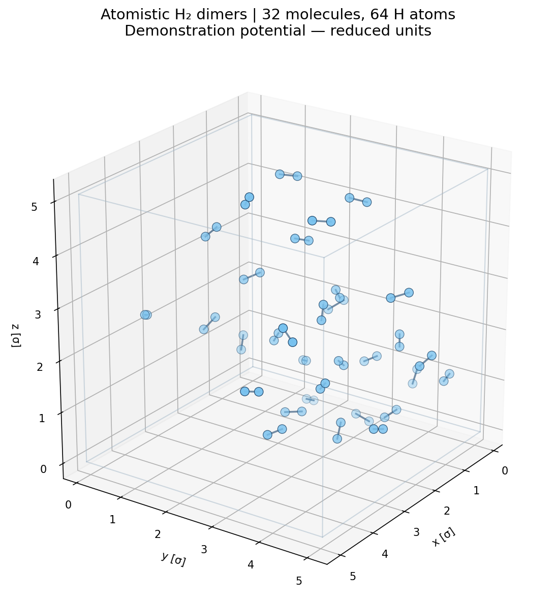
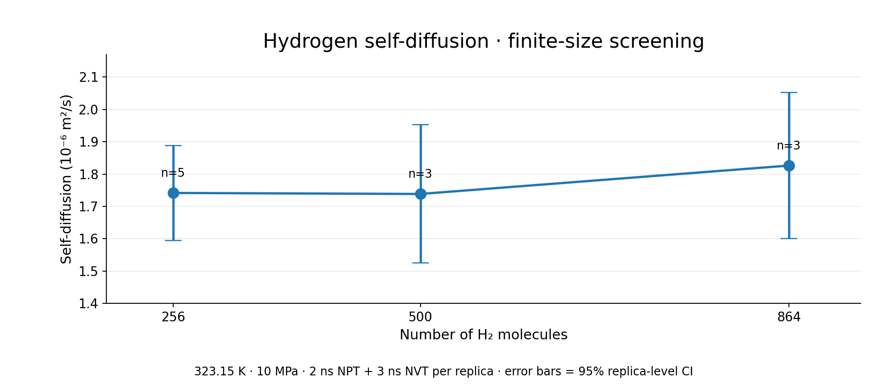

# H₂ Molecular Dynamics Toolkit

[](https://github.com/Abdelateef13/h2-molecular-dynamics-toolkit/actions/workflows/tests.yml)


**An end-to-end Python + LAMMPS framework for molecular simulation and analysis of hydrogen.** Configure experiments, generate two-site H₂ simulations, calculate molecular transport and structural properties, quantify uncertainty, and explore results in an interactive dashboard.



**[Quick start](#quick-start) · [Results](#example-benchmark) · [Workflow](#reproducible-lammps-workflow) · [Scientific model](#scientific-model-and-scope) · [Documentation](#documentation)**

## What the toolkit does

| Component | Capabilities |
|---|---|
| **Simulation** | Generate LAMMPS inputs for rigid two-site H₂, with NPT equilibration, NVT production, SHAKE constraints, and independent seeds |
| **Trajectory analysis** | Unwrapped molecular center-of-mass (COM) reconstruction, MSD and self-diffusion, H₂–H₂ RDF, bond-length diagnostics |
| **Validation** | NPT density comparison with the CoolProp normal-hydrogen EOS, replicate statistics, 95% confidence intervals, convergence warnings |
| **Visualization** | Interactive 3D molecule animation, MSD and density plots, finite-size comparison dashboard |
| **Reproducibility** | JSON experiment configs, Python CLI, automated tests, versioned example analyses, machine-readable exports |


## Example benchmark

The following results were obtained from the repository owner's LAMMPS campaigns at **323.15 K and 10 MPa**, with **2 ns NPT + 3 ns NVT per independent replica**. The EOS reference is **7.1001 kg/m³**.

| H₂ molecules | Replicas | MD density (kg/m³) | Density error vs EOS | Self-diffusion (10⁻⁶ m²/s) |
|---:|---:|---:|---:|---:|
| 256 | 5 | 7.1087 ± 0.0289 | +0.122% | 1.7417 ± 0.1472 |
| 500 | 3 | 7.0885 ± 0.0502 | −0.163% | 1.7386 ± 0.2139 |
| 864 | 3 | 7.0955 ± 0.0395 | −0.064% | 1.8264 ± 0.2263 |

*All ± values are **95% confidence-interval half-widths across independent replicas**, not force-field accuracy bounds. The three sizes do not establish finite-size independence. Results are owner-reported and have not been independently reprocessed from raw trajectories in this distribution.*



**[Finite-size comparison report](portfolio_report/RESULTS.md)** · **[Download the interactive dashboard](portfolio_report/dashboard.html)** (save the HTML file and open it locally; GitHub does not run interactive HTML inside the README)

## Quick start

### Requirements

- Python **3.10+**
- [LAMMPS](https://www.lammps.org/) on `PATH` for running the physics-based H₂ campaigns (`lmp` executable; tested by the maintainer with LAMMPS 15 Jun 2023 on Windows)
- No LAMMPS installation required to view existing analysis summaries or run the built-in educational demos

From the **repository root** on Windows:

```bat
py -m venv .venv
.venv\Scripts\activate.bat
python -m pip install -e ".[dev,validation]"
python -m pytest -q
```

Generate an interactive two-atom **educational** H₂ demonstration:

```bat
h2md atomistic-demo --output results/atomistic
start results\atomistic\h2_interactive.html
```

Generate a dashboard from previously analyzed LAMMPS runs (no new simulation required):

```bat
h2md-workflow dashboard --analyses lammps\paper_h2\validation_v05\analysis_research lammps\paper_h2\validation_v05\analysis_500 lammps\paper_h2\validation_v05\analysis_864 --out portfolio_report
start portfolio_report\dashboard.html
```

Those three `analysis_*` directories must exist locally for the command above. To explore a packaged example instead, use the summaries in `examples/owner_reported_summaries/analysis_*`:

```bat
h2md-workflow dashboard --analyses examples\owner_reported_summaries\analysis_research examples\owner_reported_summaries\analysis_500 examples\owner_reported_summaries\analysis_864 --out portfolio_report
```

## Reproducible LAMMPS workflow

A campaign can be defined in a single JSON file, with temperature, pressure, cell count, sampling duration and random seeds. The supplied [example campaign](examples/campaigns/h2_baseline.json) demonstrates three molecular system sizes.

```bat
REM 1. Generate all inputs, without running LAMMPS
h2md-workflow plan --config examples\campaigns\h2_baseline.json --campaign campaigns\baseline

REM 2. Execute the prepared jobs (LAMMPS required)
h2md-workflow run --campaign campaigns\baseline --lmp lmp

REM 3. Analyze all completed runs
h2md-workflow analyze --campaign campaigns\baseline

REM 4. Generate comparison dashboard
h2md-workflow dashboard --analyses campaigns\baseline\h2_256\analysis campaigns\baseline\h2_500\analysis campaigns\baseline\h2_864\analysis --out portfolio_report
```

The workflow preserves run metadata and avoids overwriting a nonempty campaign directory. Large trajectory outputs are excluded from Git through `.gitignore`.

## Scientific model and scope

The LAMMPS hydrogen workflow uses the **two-site H₂ Lennard–Jones parameters** reported by Adam *et al.* (2024), Table 1:

| Site parameter | Value |
|---|---:|
| σ | 2.7200 Å |
| ε | 0.0199 kcal/mol |
| Charge | 0 e |
| LJ cutoff | 12.8 Å |
| H–H separation | 0.7414 Å — **separately assumed rigid-bond approximation** |

NPT equilibration provides density; NVT production provides unwrapped H₂ COM trajectories for Einstein self-diffusion:

$$D = \frac{1}{6} \frac{d}{dt} \left\langle |\mathbf{R}_{\mathrm{COM}}(t+t_0)-\mathbf{R}_{\mathrm{COM}}(t_0)|^2 \right\rangle.$$

**Interpretation limits:** The paper supplies the nonbonded LJ parameters, not the rigid-bond parameterization used in this implementation. The model is classical and does not explicitly reproduce nuclear quantum effects. Good density agreement at one state is not validation of self-diffusion across all conditions. The 95% CIs quantify between-replica variability, not systematic potential, thermostat, fitting, or box-size bias. The included `h2md demo` and `h2md atomistic-demo` modes are separate **educational reduced-unit models**, not quantitative H₂ force-field calculations.

## Repository layout

```text
src/h2md/                       Python simulation, analysis and workflow modules
lammps/paper_h2/                Paper-based two-site H₂ LAMMPS inputs
lammps/paper_h2/validation_v05/ Independent replicas, EOS benchmark and diffusion
examples/campaigns/            JSON campaign configurations
examples/atomistic-demo/       3D demonstration and example outputs
tests/                         Unit and workflow regression tests
assets/                        Molecular visualizations and benchmark figures
portfolio_report/              Example dashboard and comparison exports
docs/                          Architecture and model documentation
```

## Documentation

- [Architecture and workflow design](docs/FINAL_FRAMEWORK.md)
- [Force-field provenance and assumptions](docs/PAPER_H2_FORCEFIELD.md)
- [Density and self-diffusion analysis](lammps/paper_h2/validation_v05/README.md)
- [Changelog](CHANGELOG.md)
- [Citing this software](CITATION.cff)

## Roadmap

- More flexible LAMMPS trajectory import (additional box types and dump conventions)
- Configurable analysis modules and export options
- Extendible model support for additional gases and liquids, with model-specific force fields and validation

## Reference and citation

**Force-field source:** Adam, A. M., Bahamon, D., Al Kobaisi, M., & Vega, L. F. (2024). *Molecular dynamics simulations of the interfacial tension and the solubility of brine/H₂/CO₂ systems: Implications for underground hydrogen storage*. **International Journal of Hydrogen Energy, 78**, 1344–1354. [https://doi.org/10.1016/j.ijhydene.2024.06.319](https://doi.org/10.1016/j.ijhydene.2024.06.319).

This repository is licensed under the [MIT License](LICENSE). For software attribution, see [`CITATION.cff`](CITATION.cff).
